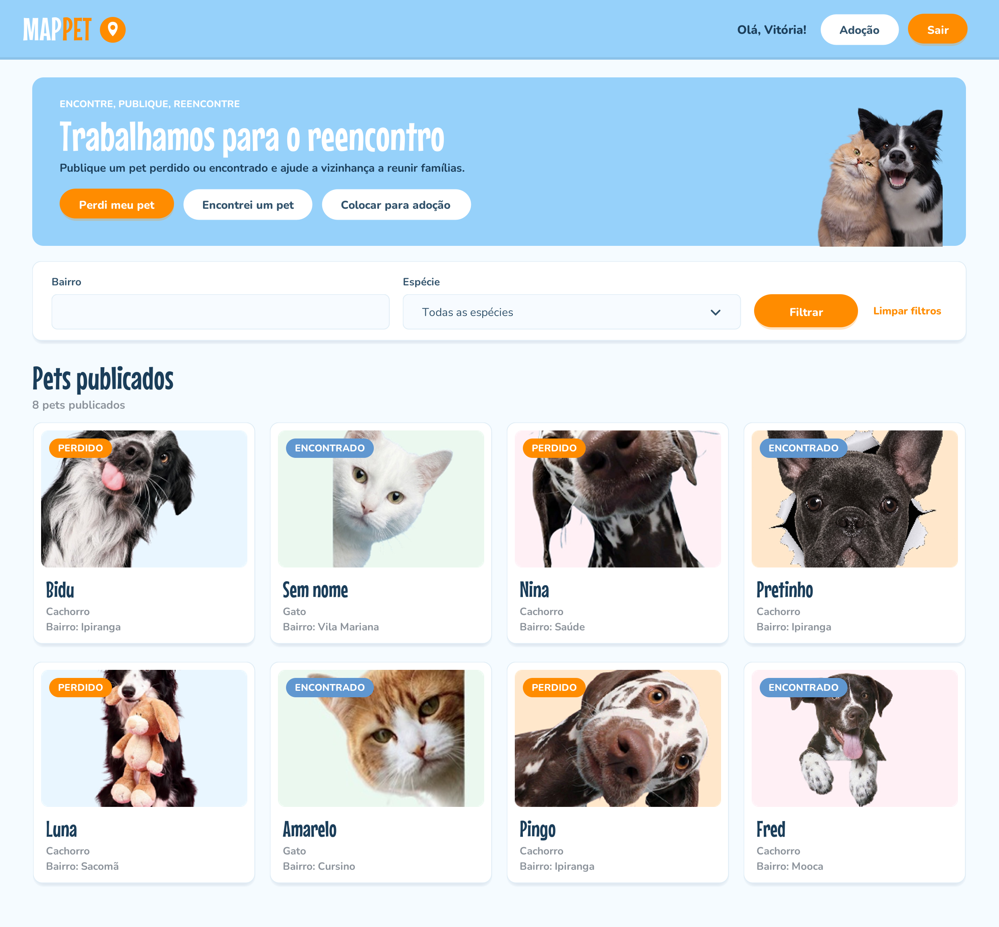
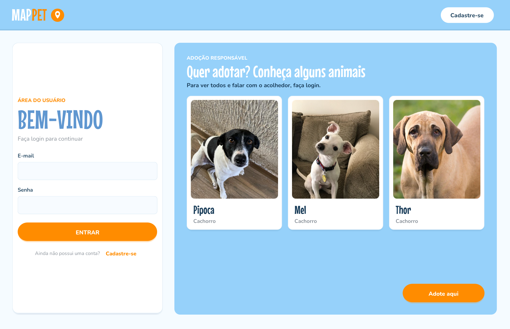
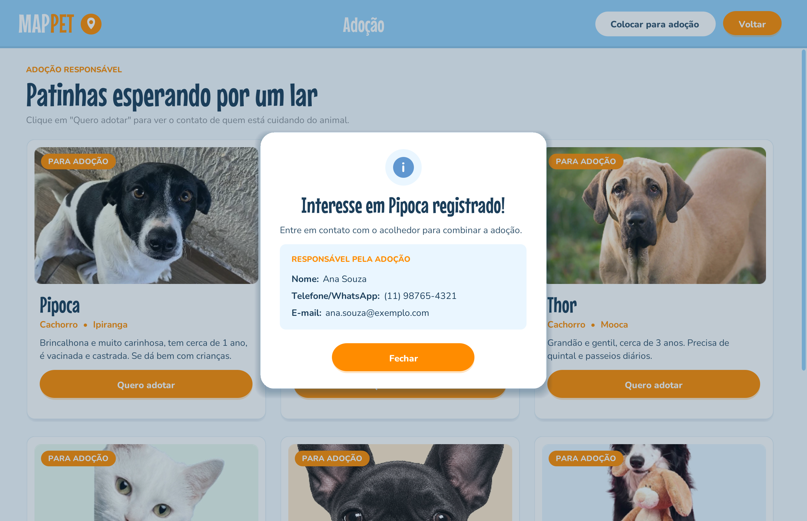

<div align="center">

# 🐾 MAPPET

**Plataforma para reencontrar pets perdidos e encaminhar adoções responsáveis**

Projeto Integrador do curso de Análise e Desenvolvimento de Sistemas da FATEC Ipiranga, construído de forma evolutiva do 1º ao 6º semestre.




</div>

## O problema

Quando um animal some, a busca acontece espalhada em grupos de WhatsApp, posts em redes sociais e cartazes na rua. As informações se perdem rápido, não dá para buscar por bairro ou espécie e quem encontrou um pet não sabe onde avisar. Na pesquisa feita no 1º semestre com 37 pessoas, a maioria já tinha perdido um animal ou conhecia alguém que perdeu, e mais de 90% disse que usaria uma plataforma própria para isso.

## A solução

O MAPPET centraliza esse processo:

* o tutor publica o pet perdido com foto e o bairro onde ele foi visto pela última vez;
* quem encontrou um animal publica o avistamento;
* qualquer pessoa da região filtra os anúncios por bairro e espécie;
* acolhedores colocam animais do lar temporário para adoção, e o adotante só vê o contato depois de registrar o interesse, o que deixa um rastro de quem pediu o contato e quando.

## Evolução por semestre

| Fase | Foco | Principais entregas | Status |
|---|---|---|---|
| [PI I](mappet-pi-1) | Análise do problema e prototipação | Pesquisa com a comunidade, requisitos, modelagem inicial, protótipo e primeiro código em Java | ✅ Concluído |
| [PI II](mappet-pi-2) | Modelagem e funcionalidades básicas | Casos de uso, banco de dados Oracle, MVP desktop em Java, interface web, plano de segurança e LGPD, testes | ✅ Concluído |
| [PI III](mappet-pi-3) | Integração | Back end em Java no servidor e interface web ligada ao banco | 🔜 Próximo semestre |
| [PI IV](mappet-pi-4) | A definir | Conforme as disciplinas do semestre | 📅 Planejado |
| [PI V](mappet-pi-5) | A definir | Conforme as disciplinas do semestre | 📅 Planejado |
| [PI VI](mappet-pi-6) | A definir | Conforme as disciplinas do semestre | 📅 Planejado |

## O que já foi construído (PI II)

| Login com vitrine de adoção | Contato liberado após o interesse |
|---|---|
|  |  |

**Destaques técnicos**

* **Arquitetura em camadas:** MVC com DAO no módulo Java. As telas não conhecem SQL e só os DAOs acessam o banco.
* **Banco relacional modelado do zero:** MER na notação de Peter Chen, modelo lógico e físico no Oracle, com 5 tabelas, chaves, restrições e índices.
* **Segurança desde o início:** senhas com hash BCrypt, `PreparedStatement` em todas as consultas, validação do conteúdo real das fotos, mensagem única para login inválido e contato liberado só para usuário autenticado.
* **Privacidade e proteção infantil:** plano de segurança alinhado à LGPD e ao ECA, pensando em como evitar que a plataforma seja usada para abordar crianças e adolescentes.
* **Testes:** 23 testes automatizados das regras, todos aprovados, e testes de interface com evidência em captura de tela.
* **Documentação acadêmica completa** nas normas ABNT, com diário de bordo do semestre.

Os detalhes estão no [README do PI II](mappet-pi-2).

## Tecnologias

| Camada | Tecnologias |
|---|---|
| Interface web | HTML5, CSS3, JavaScript |
| Módulo funcional | Java 11, Swing, Maven |
| Banco de dados | Oracle, JDBC (ojdbc11), SQL |
| Segurança | jBCrypt, LGPD, ECA |
| Modelagem | UML (casos de uso), BPMN, MER, MLR |

## Estrutura do repositório

```text
mappet/
├── mappet-pi-1/   análise, pesquisa, requisitos e protótipo
├── mappet-pi-2/   modelagem, banco de dados, MVP desktop, interface web, segurança e testes
├── mappet-pi-3/   próximo semestre
├── mappet-pi-4/
├── mappet-pi-5/
└── mappet-pi-6/
```

Cada pasta tem um README próprio que explica o que foi feito naquela fase e como navegar pelos arquivos.

## Ideias para as próximas fases

Levantadas pela comunidade e pelo grupo ao longo do projeto, ainda sem fase definida:

* mapa com a localização aproximada dos avistamentos;
* aviso por e-mail quando aparecer um pet compatível na região;
* encerramento do anúncio quando o pet for reencontrado;
* reconhecimento de imagem para comparar fotos de perdidos e encontrados;
* versão mobile e parceria com ONGs e clínicas veterinárias.

## Equipe

| Integrante |
|---|
| Giovana Yuri Nakamura |
| Karine Cristina de Figueiredo |
| Maria Eduarda de Andrade Souza Alves |
| Sarah Fernandes de Araújo |
| Vitória Pereira de Lucena |

**Orientação:** Profª. Ana Travassos Ichihara
**Instituição:** FATEC Ipiranga, Análise e Desenvolvimento de Sistemas, período da tarde
