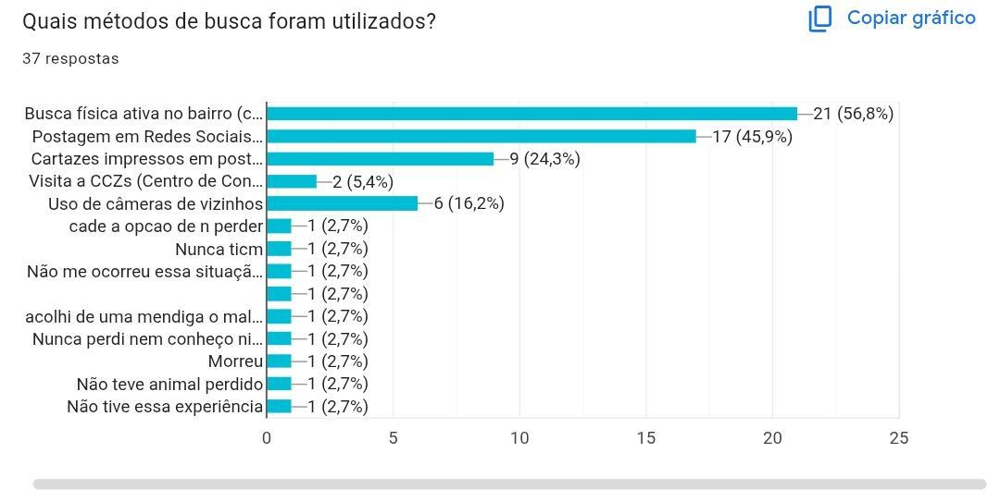
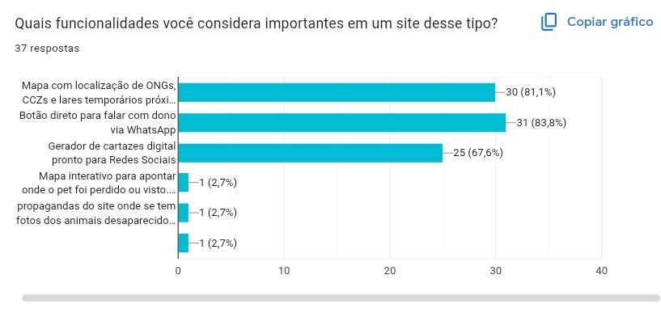
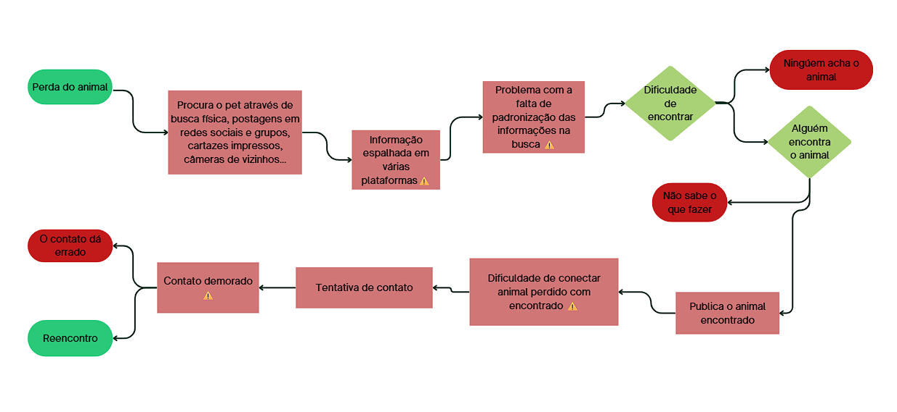

# MAPPET PI I: das análises à prototipação inicial

**1º semestre de 2026** · FATEC Ipiranga · Análise e Desenvolvimento de Sistemas

Nesta primeira fase o objetivo foi entender o problema de verdade antes de escrever código: conversar com a comunidade, levantar requisitos, modelar o sistema e construir um primeiro protótipo.

## O que foi feito

1. **Pesquisa com a comunidade.** Questionário respondido por 37 pessoas e conversa com uma protetora independente de animais da região, para entender como as buscas acontecem hoje e o que faria diferença.
2. **Levantamento de requisitos.** Requisitos funcionais, não funcionais e regras de negócio da plataforma.
3. **Modelagem.** Primeiros diagramas e o fluxo do processo atual de busca por um pet perdido.
4. **Protótipo.** Telas da interface web, testes de usabilidade e ajustes de layout a partir deles.
5. **Primeiro código em Java.** Programa de console que cadastra pets perdidos e encontrados em listas e os exibe, aplicando a lógica de programação estudada no semestre.

## O que a pesquisa mostrou

| Pergunta | Resultado |
|---|---|
| Você ou alguém próximo já perdeu um animal? |  |
| Quais métodos de busca foram usados? |  |
| Quais funcionalidades seriam importantes? |  |
| Você usaria um site para divulgar ou procurar um animal perdido? |  |

O processo atual, mapeado a partir das entrevistas, mostra onde a busca trava: a informação fica espalhada e quem encontra um animal não tem onde avisar.



## Estrutura da pasta

| Pasta | Conteúdo |
|---|---|
| [`docs`](docs) | Documentação completa do PI I em PDF, nas normas ABNT |
| [`codigo-java`](codigo-java) | Primeiro código em Java (console) |
| [`pesquisa`](pesquisa) | Gráficos do questionário e o fluxo do processo atual |

## Rodando o código Java

```
cd codigo-java
javac Main.java
java Main
```

O menu permite cadastrar um pet perdido, cadastrar um encontrado, listar os registros e sair. Os dados ficam só na memória enquanto o programa está aberto.

## Disciplinas integradas

Algoritmos e Lógica de Programação, Engenharia de Software I, Arquitetura e Organização de Computadores e Sistemas Operacionais.

## O que levamos para o PI II

O escopo inicial era grande (mapa, notificações, cruzamento automático de dados). No PI II o grupo priorizou o que entrega valor primeiro: cadastro e login, publicação com foto, filtros por bairro e espécie e uma área de adoção, agora com banco de dados real e código organizado em camadas. Veja em [mappet-pi-2](../mappet-pi-2).
