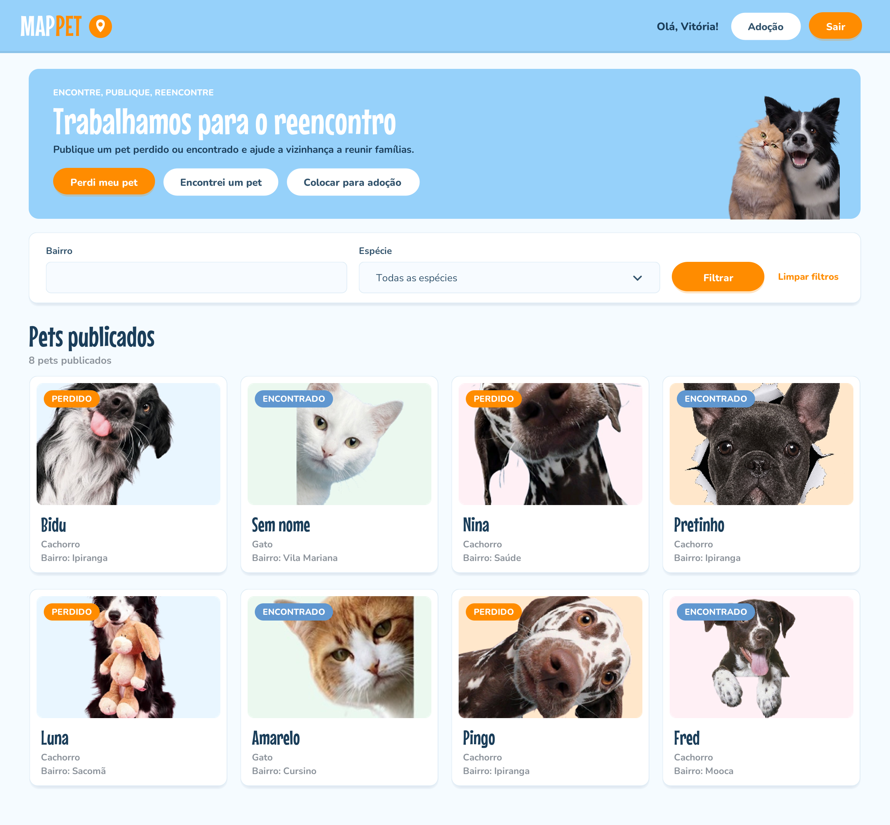
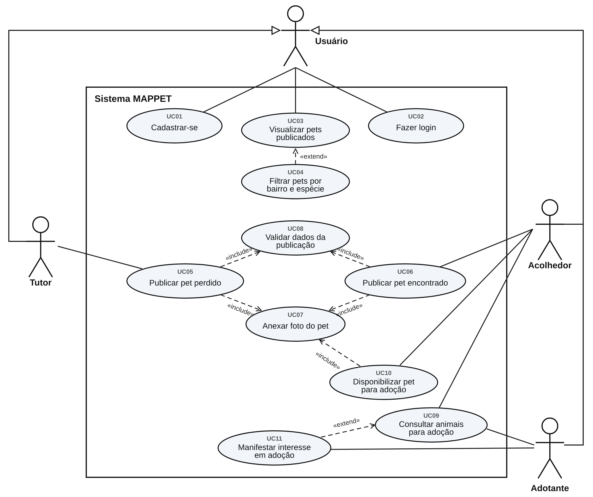
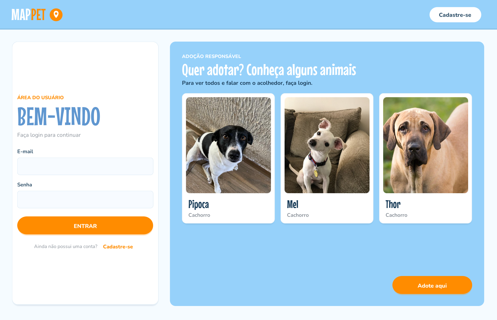
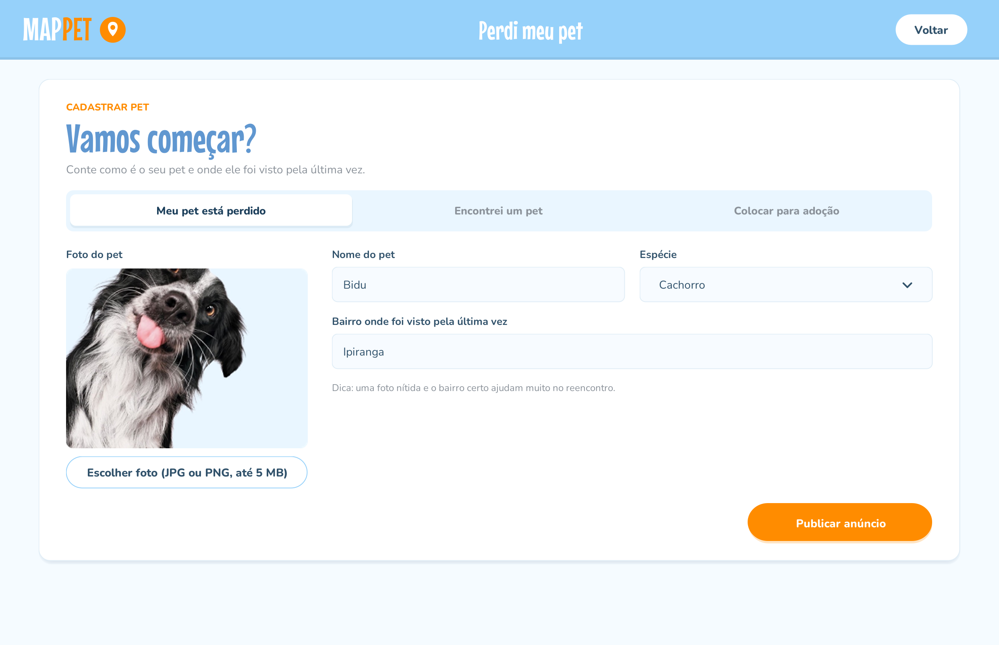
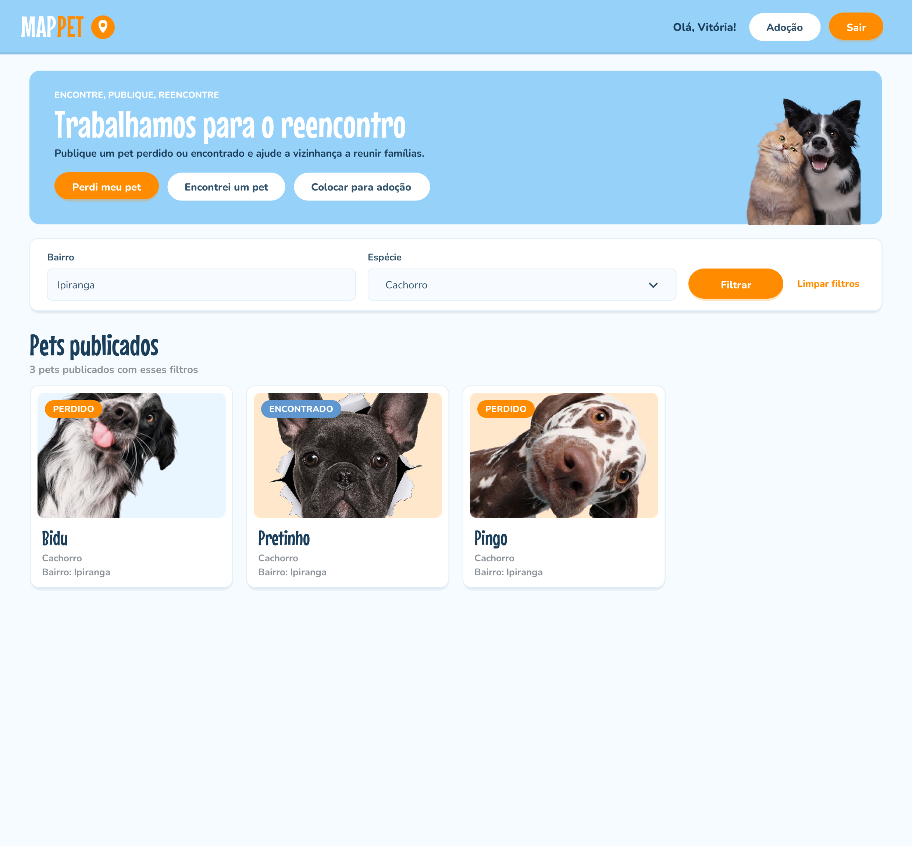
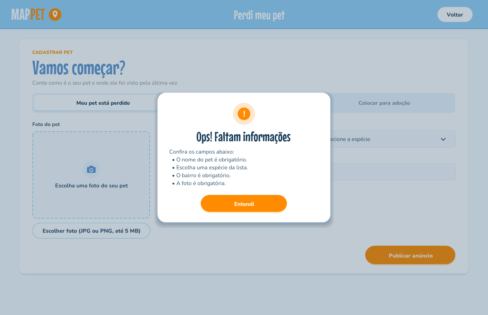
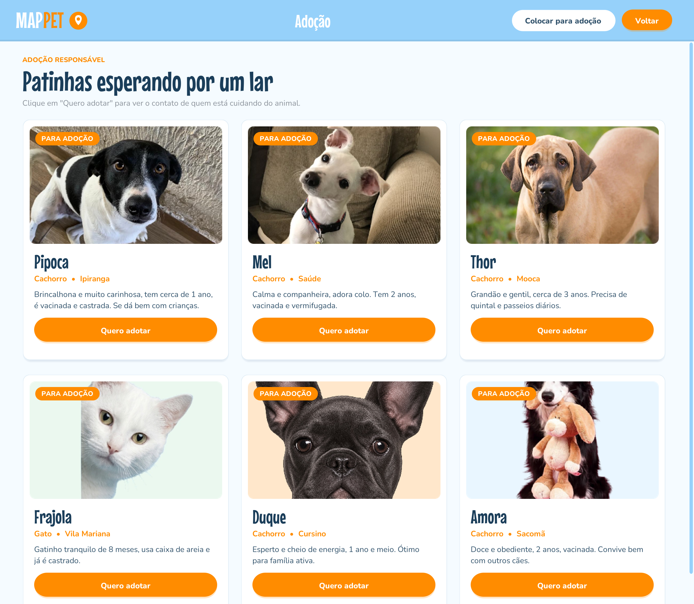
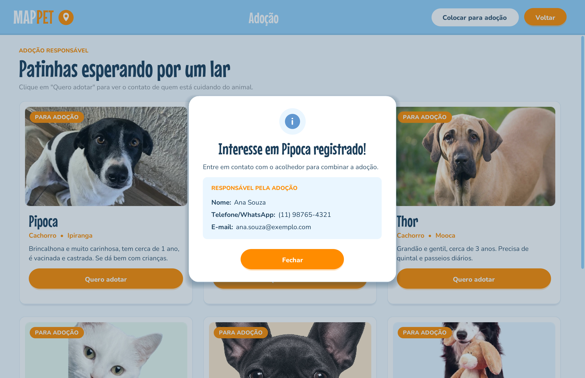
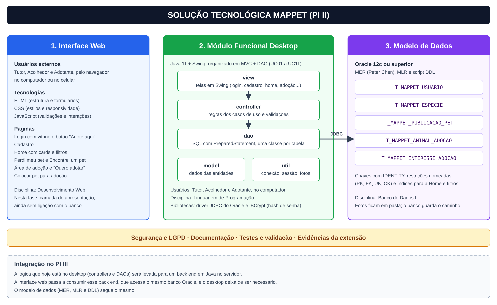
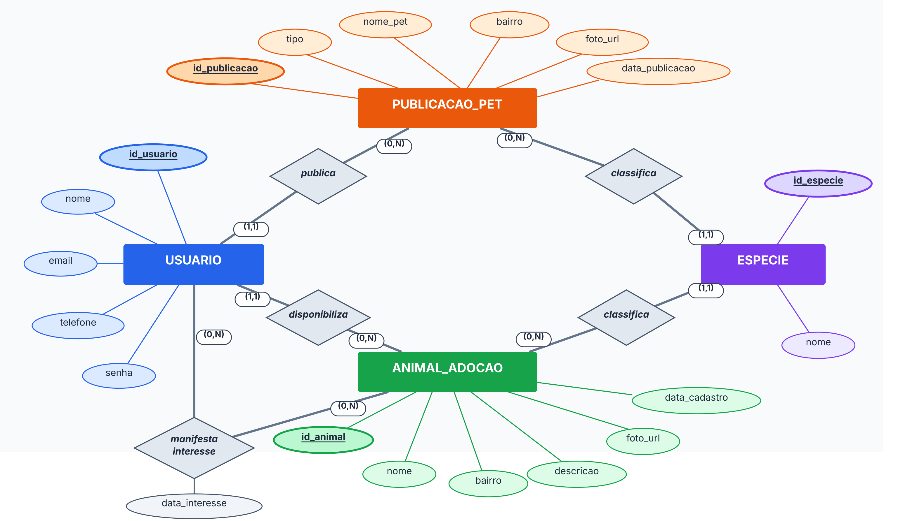

# MAPPET PI II: modelagem de alto nível e implementação de funcionalidades básicas

**2º semestre de 2026** · FATEC Ipiranga · Análise e Desenvolvimento de Sistemas
**Orientação:** Profª. Ana Travassos Ichihara

No PI I o MAPPET era uma ideia validada com a comunidade. No PI II ele virou software: casos de uso detalhados, banco de dados Oracle modelado do zero, um MVP em Java que cobre todo o escopo, uma interface web e um plano de segurança focado em LGPD e na proteção de crianças e adolescentes.

<p align="center">
  
</p>

## Sumário

1. [Escopo da fase](#escopo-da-fase)
2. [Funcionalidades](#funcionalidades)
3. [Arquitetura](#arquitetura)
4. [Modelo de dados](#modelo-de-dados)
5. [Segurança e LGPD](#segurança-e-lgpd)
6. [Testes](#testes)
7. [Como executar](#como-executar)
8. [Estrutura da pasta](#estrutura-da-pasta)
9. [Disciplinas integradas](#disciplinas-integradas)
10. [Aprendizados](#aprendizados)
11. [Equipe](#equipe)

## Escopo da fase

O incremento foi definido em 11 casos de uso, todos implementados no MVP:

| Caso de uso | Descrição | Quem usa |
|---|---|---|
| UC01 | Cadastrar-se | Visitante |
| UC02 | Fazer login (e sair) | Usuário |
| UC03 | Visualizar pets publicados | Usuário |
| UC04 | Filtrar pets por bairro e espécie | Usuário |
| UC05 | Publicar pet perdido | Tutor |
| UC06 | Publicar pet encontrado | Usuário |
| UC07 | Anexar foto do pet | Tutor, Acolhedor |
| UC08 | Validar dados da publicação | Sistema |
| UC09 | Consultar animais para adoção | Adotante |
| UC10 | Disponibilizar pet para adoção | Acolhedor |
| UC11 | Manifestar interesse em adoção | Adotante |

Tutor, Acolhedor e Adotante não são pessoas diferentes: são papéis que o mesmo usuário assume, o que aparece no diagrama como generalização entre atores.

<p align="center">
  
</p>

Ficaram para as próximas fases, de forma consciente: notificação de avistamento por e-mail, encerramento do anúncio quando o pet é reencontrado e os filtros por raça, cor e porte.

## Funcionalidades

| | |
|---|---|
| **Login com vitrine de adoção.** Sem login, a tela mostra só foto, nome e espécie de alguns animais. |  |
| **Publicar pet perdido ou encontrado** com foto, espécie e bairro, em abas como na área do usuário do site. |  |
| **Filtros por bairro e espécie** na Home, com mensagem clara quando nada é encontrado. |  |
| **Validação com retorno amigável.** O sistema lista tudo que falta corrigir de uma vez e mantém o que já foi digitado. |  |
| **Área de adoção** só para usuários logados. |  |
| **"Quero adotar".** O interesse é gravado antes de o contato do acolhedor aparecer. Clicar de novo no mesmo animal não duplica o registro. |  |

Todas as telas, do desktop e da web, estão em [`telas`](telas).

## Arquitetura

O sistema tem três partes que compartilham o mesmo modelo de dados:

* **Interface web** (`web/`): HTML, CSS e JavaScript, a face pública da plataforma. Nesta fase os dados ficam no navegador, porque a ligação com o banco chega no PI III.
* **Módulo funcional** (`desktop/`): aplicação Java que implementa todos os casos de uso com banco real. É o MVP da atividade de extensão.
* **Banco de dados** (`banco-de-dados/`): Oracle, com o script DDL completo.

<p align="center">
  
</p>

Dentro do módulo Java o código segue **MVC com DAO**:

```text
view  ─────►  controller  ─────►  dao  ─────►  Oracle
telas Swing   regras dos casos    SQL com
              de uso e            PreparedStatement
              validações
```

* As telas só falam com os controllers e não sabem que existe banco.
* Os controllers aplicam as regras de cada caso de uso (os passos do caso de uso estão anotados nos comentários do código).
* Só os DAOs têm SQL, uma classe por tabela.

O visual das telas Swing foi refeito para seguir a identidade da interface web: mesmas cores, fontes (Mouse Memoirs e Nunito), botões e cards arredondados. Como o Swing não usa CSS, esses elementos viraram componentes próprios no pacote `view`, e trocar uma cor ou fonte é feito em um único lugar.

## Modelo de dados

Modelado em três níveis: conceitual (MER na notação de Peter Chen), lógico (MLR) e físico (Oracle).

<p align="center">
  
</p>

| Tabela | Guarda |
|---|---|
| `T_MAPPET_USUARIO` | Usuários, com a senha só em hash |
| `T_MAPPET_ESPECIE` | Espécies que podem ser escolhidas nas publicações |
| `T_MAPPET_PUBLICACAO_PET` | Anúncios de pets perdidos e encontrados |
| `T_MAPPET_ANIMAL_ADOCAO` | Animais de lar temporário disponíveis para adoção |
| `T_MAPPET_INTERESSE_ADOCAO` | Quem demonstrou interesse em qual animal e quando (relacionamento N:N) |

O detalhe de cada coluna, as chaves e os índices estão em [`banco-de-dados`](banco-de-dados).

## Segurança e LGPD

Uma plataforma que coloca desconhecidos em contato por causa de animais também pode atrair pessoas mal intencionadas, inclusive interessadas em abordar crianças. Por isso o plano de segurança tem dois focos: tratar corretamente os dados pessoais (LGPD) e proteger crianças e adolescentes (ECA). As medidas foram desenhadas para funcionar com o modelo de dados atual, sem novas tabelas.

O que já está no código:

* senhas guardadas só como hash **BCrypt**;
* todas as consultas com **`PreparedStatement`**, o que impede SQL injection;
* login inválido sempre com a mesma mensagem, para não revelar quais e-mails têm conta;
* foto validada pelo **conteúdo do arquivo**, não só pela extensão, com limite de 5 MB;
* o contato do acolhedor só aparece para usuário autenticado e depois que o interesse fica registrado, o que permite saber quem pediu cada contato;
* o autor de cada publicação vem sempre da sessão, nunca de um valor digitado.

O plano completo está em [`docs/seguranca`](docs/seguranca).

## Testes

| Grupo | Casos | Resultado |
|---|---|---|
| Regras automatizadas (validações, fotos, sessão, controllers) | CT01 a CT23 | ✅ 23 de 23 aprovados |
| Interface, com evidência em captura de tela | CT24 a CT30 | ✅ Conformes |
| Banco de dados no Oracle | CT31 a CT36 | ⏳ A executar no ambiente da Fatec |

O programa de teste e o resultado da execução estão em [`testes`](testes).

## Como executar

**Interface web:** abra `web/index.html` no navegador. Não precisa instalar nada.

**MVP desktop:** precisa de JDK 11 ou mais novo, Maven e acesso a um Oracle.

```bash
# 1. crie as tabelas rodando banco-de-dados/MAPPET_Modelo_Fisico.sql no SQL Developer
#    e cadastre as espécies em T_MAPPET_ESPECIE
# 2. configure a conexão
cd desktop
cp config.properties.example config.properties   # preencha URL, usuário e senha do Oracle
# 3. compile e rode
mvn package
java -jar target/mappet-desktop.jar
```

O passo a passo completo, inclusive pelo NetBeans e pelo Eclipse, está no [README do desktop](desktop).

## Estrutura da pasta

```text
mappet-pi-2/
├── web/               interface web (HTML, CSS, JavaScript)
├── desktop/           MVP em Java (Swing, MVC + DAO, JDBC, Maven)
├── banco-de-dados/    MER, MLR, modelo físico e script DDL para Oracle
├── testes/            programa de teste, imagens de teste e resultado
├── telas/             capturas das telas do desktop e da web
└── docs/
    ├── MAPPET_PI_II.pdf      documentação completa (ABNT)
    ├── casos-de-uso/         especificação, diagrama e processo em BPMN
    ├── arquitetura/          diagrama de arquitetura
    ├── seguranca/            plano de segurança (LGPD e proteção infantil)
    ├── diario-de-bordo/      registro das atividades do semestre
    └── sugestoes-de-melhoria/
```

## Disciplinas integradas

| Disciplina | Onde aparece |
|---|---|
| Engenharia de Software II | Casos de uso, BPMN, requisitos, arquitetura e testes |
| Banco de Dados | MER, MLR, modelo físico e script DDL no Oracle |
| Linguagem de Programação I | MVP em Java com MVC e DAO |
| Desenvolvimento Web | Interface web em HTML, CSS e JavaScript |
| Compliance e Segurança da Informação | Plano de segurança, LGPD e ECA |
| Inglês II | Leitura de documentação técnica e abstract da documentação |

## Aprendizados

* **Cortar escopo é uma decisão de projeto.** O PI I prometia mapa, notificações e cruzamento automático. Priorizar o que entrega valor primeiro permitiu chegar a um MVP que funciona de ponta a ponta.
* **Modelar antes de programar economiza retrabalho.** O MER e os casos de uso guiaram o código, e as revisões com a professora (como a correção do diagrama de casos de uso) aconteceram antes de virar refatoração.
* **Segurança não é uma etapa no fim.** Pensar em quem poderia usar mal a plataforma mudou o desenho da área de adoção: o contato só aparece depois do interesse registrado.
* **Separar camadas paga rápido.** Quando as telas desktop foram redesenhadas para seguir o visual do site, nenhuma regra ou SQL precisou mudar.

## Equipe

Giovana Yuri Nakamura · Karine Cristina de Figueiredo · Maria Eduarda de Andrade Souza Alves · Sarah Fernandes de Araújo · Vitória Pereira de Lucena
