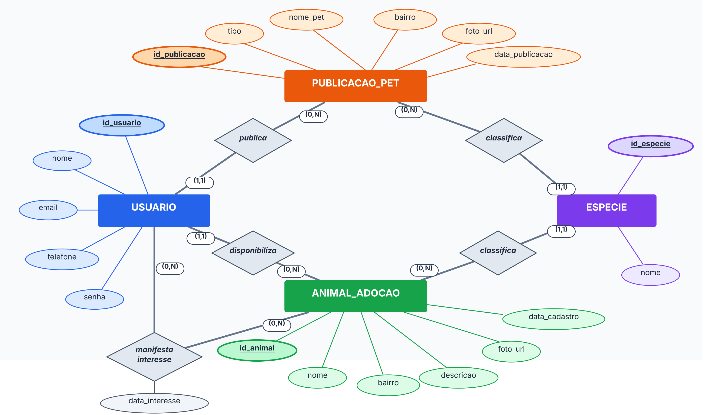

# Banco de dados

Modelo de dados do MAPPET no Oracle, construído em três níveis.

| Arquivo | Nível | Conteúdo |
|---|---|---|
| `MAPPET_MER.pdf` / `.png` | Conceitual | Entidades, atributos e relacionamentos na notação de Peter Chen |
| `MAPPET_MLR.pdf` / `.png` | Lógico | Tabelas, chaves primárias e estrangeiras |
| `MAPPET_Modelo_Fisico.pdf` / `.png` | Físico | Tipos de dados do Oracle, restrições e índices |
| `MAPPET_Modelo_Fisico.sql` | Físico | Script DDL que cria tudo |

<p align="center"></p>

## Tabelas

| Tabela | Descrição |
|---|---|
| `T_MAPPET_USUARIO` | Usuários da plataforma. A senha fica só em hash BCrypt e o e-mail é único |
| `T_MAPPET_ESPECIE` | Lista de espécies usada nas publicações e na adoção |
| `T_MAPPET_PUBLICACAO_PET` | Anúncios de pets perdidos e encontrados, com tipo, nome, bairro, foto e autor |
| `T_MAPPET_ANIMAL_ADOCAO` | Animais de lar temporário disponíveis para adoção |
| `T_MAPPET_INTERESSE_ADOCAO` | Relacionamento N:N entre usuário e animal, com a data do interesse. A chave primária composta impede registrar o mesmo interesse duas vezes |

O padrão de nomes `T_MAPPET_ENTIDADE` segue o usado na disciplina de Banco de Dados.

## Como criar

1. Abra o SQL Developer conectado ao seu usuário do Oracle.
2. Rode o `MAPPET_Modelo_Fisico.sql`.
3. Cadastre as espécies:

```sql
INSERT INTO T_MAPPET_ESPECIE (NOME) VALUES ('Cachorro');
INSERT INTO T_MAPPET_ESPECIE (NOME) VALUES ('Gato');
COMMIT;
```

O mesmo script está no projeto do MVP como `desktop/criar_tabelas.sql`.
