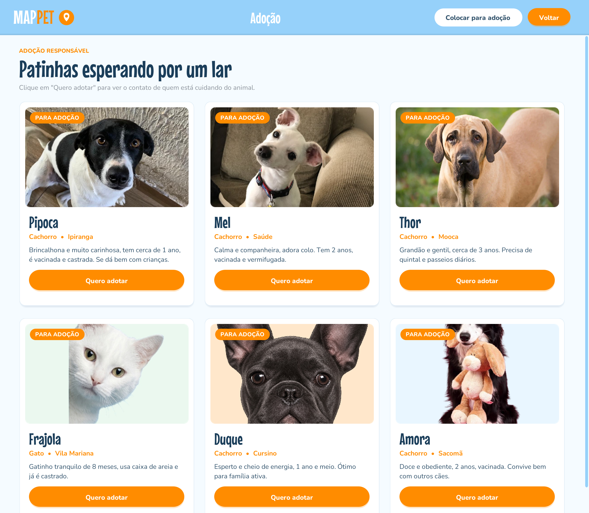

# MAPPET Desktop (MVP)

<p align="center"></p>

Aplicação desktop em Java (Swing) do MAPPET, com banco Oracle. Cobre os casos de uso UC01 a UC11.

## O que precisa ter instalado

1. JDK 11 ou mais novo
2. Maven (o NetBeans e o Eclipse já trazem)
3. Acesso a um Oracle 12c ou mais novo (o da Fatec ou um Oracle XE no seu PC)

## Como rodar

1. **Abrir o projeto.** No NetBeans: File > Open Project e escolha esta pasta. No Eclipse: File > Import > Existing Maven Projects. Na primeira vez o Maven baixa sozinho o driver do Oracle e o BCrypt (precisa de internet).
2. **Criar as tabelas.** Rode o `criar_tabelas.sql` (o mesmo script de [`../banco-de-dados`](../banco-de-dados)) no SQL Developer, conectado com o seu usuário do Oracle. Ele cria as 5 tabelas `T_MAPPET_` e os índices.
3. **Cadastrar as espécies.** As opções de espécie do UC08 vêm da tabela `T_MAPPET_ESPECIE`. Cadastre as espécies que o grupo definir, uma linha para cada, e depois dê `COMMIT`:
   ```sql
   INSERT INTO T_MAPPET_ESPECIE (NOME) VALUES ('Cachorro');
   INSERT INTO T_MAPPET_ESPECIE (NOME) VALUES ('Gato');
   COMMIT;
   ```
4. **Configurar a conexão.** Copie o `config.properties.example` com o nome `config.properties` (na mesma pasta do `pom.xml`) e preencha o endereço, o usuário e a senha do Oracle.
5. **Executar.** No NetBeans ou no Eclipse, rode a classe `br.com.mappet.Main`. Pelo terminal:
   ```
   mvn package
   java -jar target/mappet-desktop.jar
   ```
   O programa procura o `config.properties` e a pasta `fotos` na pasta de onde ele é executado, por isso rode sempre a partir da pasta do projeto.

## Organização do código (MVC + DAO)

```
src/main/java/br/com/mappet/
  Main.java          abre a janela
  model/             classes com os dados (Usuario, Especie, PublicacaoPet, AnimalAdocao, ContatoAcolhedor)
  dao/               SQL no Oracle, uma classe por tabela
  controller/        regras dos casos de uso e validações
  view/              telas em Swing e componentes visuais no padrão do site
  resources/fontes   fontes Mouse Memoirs e Nunito (licença SIL OFL), as mesmas da interface web
  resources/imagens  ilustrações usadas nas telas (gatinhos do cadastro e banner da Home)
  util/              conexão, sessão do usuário, validações e fotos
```

As telas só chamam os controllers. Os controllers validam os dados e chamam os DAOs. Só os DAOs têm SQL, e todo SQL usa `PreparedStatement` com parâmetros (`?`), nunca texto digitado colado no comando.

## Telas e casos de uso

| Tela | Casos de uso |
|---|---|
| Login, com o botão "Adote aqui" e alguns animais em destaque | UC02, UC09 |
| Cadastro | UC01 |
| Home com os cards e os filtros de bairro e espécie | UC03, UC04 |
| Perdi meu pet | UC05, UC07, UC08 |
| Encontrei um pet | UC06, UC07, UC08 |
| Área de adoção (só com login) | UC09 |
| Botão "Quero adotar", que registra o interesse e mostra o contato | UC11 |
| Colocar pet para adoção | UC10, UC07 |
| Botão "Sair" | UC02 A2 |

As imagens de cada tela do desktop, já no visual da interface web (cores, fontes, botões e cards do site), estão em [`../telas/desktop`](../telas/desktop).

## Regras que o sistema garante

* A senha é guardada só como hash BCrypt na coluna `SENHA_HASH` (UC01).
* O mesmo e-mail não pode ter duas contas (UC01 E2).
* Senha errada e e-mail inexistente mostram a mesma mensagem: "E-mail ou senha incorretos." (UC02 E2).
* Sem login, a tela inicial mostra só foto, nome e espécie de alguns animais. A lista completa e o contato exigem login (UC09).
* O contato do acolhedor só aparece depois que o interesse é gravado em `T_MAPPET_INTERESSE_ADOCAO`. Clicar de novo no mesmo animal não cria outro registro, só mostra o contato de novo (UC11 e UC11 A2).
* Foto só JPG ou PNG, até 5 MB. O sistema confere o conteúdo do arquivo, não só a extensão (UC07 E1).
* Nome e bairro obrigatórios, sem números e sem ficar só com espaços; espécie escolhida da lista (UC08).
* Quem publica é sempre o usuário logado, nunca um valor digitado.

## Fotos

As fotos são copiadas para a pasta `fotos` do projeto com um nome gerado pelo sistema, e o banco guarda só o caminho (`FOTO_URL`). Como é um MVP desktop, as fotos ficam no computador onde o programa roda.

## Arquivos que não vão para o GitHub

O `.gitignore` já deixa de fora o `config.properties` (tem a senha do banco), a pasta `target` e as fotos enviadas.
