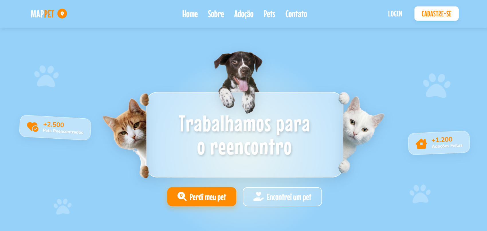

# MAPPET Web

Interface web do MAPPET em HTML, CSS e JavaScript puro, sem frameworks.

<p align="center"></p>

## Como abrir

Abra o `index.html` no navegador. Se preferir um servidor local, a extensão Live Server do VS Code funciona bem.

## Páginas

| Página | Arquivo | O que faz |
|---|---|---|
| Início | `index.html` | Apresentação, atalhos "Perdi meu pet" e "Encontrei um pet" |
| Login | `login.html` | Entrada do usuário (UC02) |
| Cadastro | `cadastro.html` | Criação de conta com validação dos campos (UC01) |
| Área do usuário | `user.html` | Abas "Meu pet está perdido", "Encontrei um pet" e "Colocar para adoção" (UC05, UC06, UC07, UC10) |
| Perdidos e encontrados | `perdidos-encontrados.html` | Listagem com filtro por localização (UC03, UC04) |
| Adoção | `adocao.html` | Animais disponíveis para adoção (UC09) |
| Detalhes do pet | `detalhes-pet.html` | Informações de um anúncio |
| Contato da adoção | `contato-adocao.html` | Quadro "Responsável pela adoção" (UC11) |

## Organização

```text
web/
├── *.html           uma página por tela
├── css/             um arquivo de estilo por página, mais o dropdown compartilhado
├── js/              um script por página; storage.js centraliza o acesso aos dados
└── assets/images/   fotos e ilustrações
```

## Limitações desta fase

A web ainda não está ligada ao banco. Os dados ficam no `localStorage` do navegador, por meio do `storage.js`, e o contato do acolhedor aparece sem exigir login. A regra completa, com login obrigatório e interesse registrado antes do contato, já funciona no [MVP desktop](../desktop) e chega à web no PI III, quando a interface passar a usar o back end em Java.

Alguns campos da interface, como UF, cidade, raça, porte e idade, ainda não existem no modelo de dados. Eles foram mantidos como preparação para os próximos incrementos.
